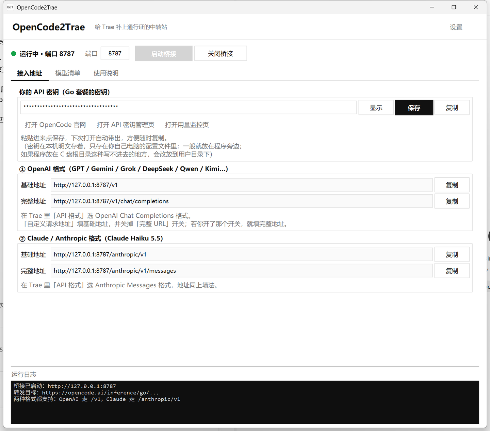
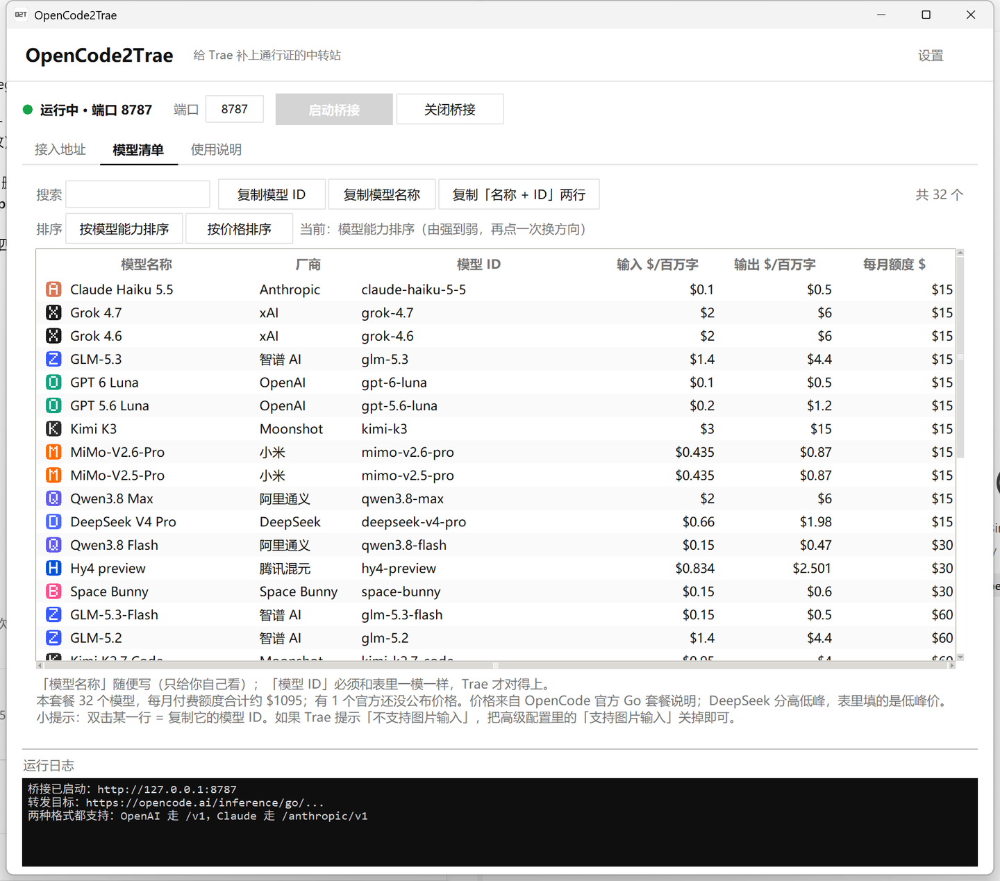

[](https://hzdavy.github.io/OpenCode2Trae/)
#  OpenCode2Trae
[](https://github.com/HZDavy/OpenCode2Trae/releases) [](LICENSE) [](https://github.com/HZDavy/OpenCode2Trae/releases/latest) [](https://github.com/HZDavy/OpenCode2Trae/releases/latest)   [](https://hzdavy.github.io/OpenCode2Trae/)
> 把 OpenCode Go 的订阅，接进 Trae 里用。

OpenCode2Trae 是一个开源、纯本地的中转站。它在你自己的电脑上开一个"小邮局"，把 Trae 发出去的模型请求接住、补上一张 OpenCode 要求的"通行证"，再原封不动转给 OpenCode。全程只在你本机跑，不经过任何第三方服务器。

单个 Python 文件，只用系统自带的东西；不想装 Python 的话，直接下打包好的 exe，双击就能用。同时支持 **OpenAI 格式** 与 **Claude（Anthropic）格式**。

---

## 界面预览





---

## 什么是"中转站"，为什么需要它

先说结论：**Trae 少了 OpenCode 要的一张"通行证"，本程序专门负责补上这张通行证。**

打个比方。你去办业务，窗口要求"必须出示工牌才给办"。可 Trae 这个"代办员"不会出示工牌——它填表时压根没有"工牌"这一栏。于是窗口把它挡在门外，Trae 只能回来跟你说：

```
WebSocket error: Network IO error: ... (HTTP Status: 500) (4028)
```

OpenCode Go 要求每个请求都带一张通行证，也就是一个叫 `x-opencode-session` 的请求头（你可以理解成"进门要刷的那张卡"）。而 Trae 的"自定义模型"设置里**没有地方能填请求头**，所以请求一到 OpenCode 就被拦下。

OpenCode2Trae 的做法很朴素：它在中间加一个"前台"。

1. Trae 把请求发到本机的 `127.0.0.1:8787`（本程序开的小前台），并且以为这就是 OpenCode；
2. 前台把请求原样收下，**替它补上那张通行证**；
3. 前台再把请求转给真正的 OpenCode，拿到结果后原路送回给 Trae。

对 Trae 来说什么都没变，对 OpenCode 来说通行证齐全，问题就消失了。

---

## 命名寓意

**OpenCode2Trae** 里的 **2** 读作英文的 "to"（去往）。整个名字就是一句话：**把 OpenCode 接到 Trae**。开头两个字母 **O2T** 是它的简称，也是图标上那三个像素字。

---

## 平台支持与路线图

| 平台 | 状态 | 说明 |
|---|---|---|
| Windows 10 / 11（x64） | ✅ 已发布 v2.1.2 | 单文件 exe，免安装，见 [Releases](https://github.com/HZDavy/OpenCode2Trae/releases) |
| 源码运行（任意系统） | ✅ 可用 | Python 3.8+，自带 tkinter 即可，无需 pip 装任何东西 |
| macOS | 📋 计划中 | 逻辑与界面都基于 Python 标准库，移植成本低 |
| Linux | 📋 计划中 | 同上 |

路线进展与讨论见 [GitHub Issues](https://github.com/HZDavy/OpenCode2Trae/issues)，欢迎参与贡献。

---

## Windows 版功能

- 一键**启动 / 关闭**中转站，左上角指示灯亮绿=已接通
- 端口可自定义（默认 `8787`）
- 记住你的 API 密钥，随时复制备用
- 界面内置**直达按钮**：一键打开 OpenCode 官网、API 密钥管理页、**用量监控页**
- 内置 Go 套餐全部 **32 个模型**的名称与 ID，支持搜索、双击即复制
- 「模型清单」支持**两种排序**（按模型能力 / 按价格，再点一次反向），并显示每个模型的
  **输入价、输出价、官方每月额度（$）**，名字前带**厂商徽章**（品牌色 + 首字母）
- 「接入地址」页直接给出 Trae 要填的地址，一键复制
- 同时支持 **OpenAI 格式** 和 **Claude（Anthropic）格式**
- **设置**里可开「托盘模式」（关闭窗口=收进托盘，而不是退出）与「开机自动启动」
- 窗口自动记住上次的位置与大小；首次打开默认出现在主屏幕中央
- 打开设置时主窗口会盖上一层**黑色半透明遮罩**，设置窗始终浮在主窗口正中央
- 单文件、核心零第三方依赖（托盘功能需 `pystray`，没装也不影响其它功能）

---

## 下载安装

到 [Releases](https://github.com/HZDavy/OpenCode2Trae/releases) 下载 `OpenCode2Trae.exe`，**免安装**，双击即用，不用装 Python。

> **SmartScreen 提示**：本项目为个人开源项目，exe 暂无代码签名证书。首次运行时 Windows 可能弹出「已保护你的电脑」，点击「更多信息」→「仍要运行」即可。软件完全开源，可自行审计源码或从源码构建。

---

## 在 Trae 里怎么接

1. 双击 `OpenCode2Trae.exe`，点界面最上面的「**启动桥接**」，左上角指示灯变绿。
2. 切到「**接入地址**」页，把 Go 套餐的密钥粘进去、点「保存」。
3. 打开 Trae → 模型设置 → 添加自定义模型，按下表填：

   | 想用的模型 | API 格式 | 请求地址 |
   | --- | --- | --- |
   | GPT / Gemini / Grok / DeepSeek / Qwen / Kimi / GLM 等 | OpenAI Chat Completions | `http://127.0.0.1:8787/v1` |
   | Claude | Anthropic Messages | `http://127.0.0.1:8787/anthropic/v1` |

   （界面里把「完整 URL」开关打开的话，就填各自带 `/chat/completions`、`/messages` 的那一版）
4. 「模型 ID」到「**模型清单**」页复制；「API 密钥」填你自己的密钥。

> **使用须知**
>
> - 本程序必须**一直开着**。关掉窗口 = 断线（开了托盘模式则收进托盘继续跑）。
> - 某个模型报「不支持图片输入」→ 去 Trae 的高级配置把「支持图片输入」关掉。
> - 报 401 之类的鉴权错误 → 是密钥的问题，不是桥接坏了。

---

## 从源码运行

需要 Python 3.8+（自带 tkinter，无需额外安装依赖）。

```bash
python OpenCode2Trae.py
```

Windows 上也可以直接双击 `OpenCode2Trae.bat`（不会弹出黑色命令行窗口）。

---

## 从源码构建 exe

```bash
pip install pyinstaller pystray
pyinstaller --noconfirm --onefile --windowed --name OpenCode2Trae ^
  --icon OpenCode2Trae.ico ^
  --add-data "OpenCode2Trae.ico;." --add-data "icon.png;." OpenCode2Trae.py
```

产物输出在 `dist/OpenCode2Trae.exe`。

---

## 隐私说明

- 程序只在本机 `127.0.0.1` 上监听，**不对外开放**，也不向任何第三方服务器上传数据。
- 你的 API 密钥只写在本机的配置文件 `opencode2trae-config.json` 里（**明文**），不上传。
- 配置文件默认放在程序旁边；若程序目录不可写（如放在 C 盘根目录），会自动改存到用户目录。
- 项目不内置任何账号、密钥或 Token。

---

## 免责声明

本项目为个人学习交流用途的非官方软件，与 OpenCode、Trae（字节跳动）官方均无任何关联，亦未获其授权或背书。所用接口均来自公开渠道，可能随时变更或失效。使用本软件产生的账号风险与损失由使用者自行承担。请在遵守 OpenCode 与 Trae 相关服务条款的前提下使用。

---

## License

本项目基于 **MIT License** 发布，全文见 [LICENSE](LICENSE)。

你可以自由使用、修改和再分发，只需保留版权与许可声明。

### 第三方开源组件

| 组件 | 用途 | 许可证 |
|---|---|---|
| [pystray](https://github.com/moses-palmer/pystray) | 托盘图标（可选） | LGPL-3.0 |
| [Pillow](https://github.com/python-pillow/Pillow) | 图片处理（pystray 依赖，可选） | MIT-CMU |
| [PyInstaller](https://github.com/pyinstaller/pyinstaller) | 打包 exe | GPL-2.0+（含例外条款） |

> 核心功能（中转、界面）仅使用 Python 标准库，不依赖上述任何组件。
