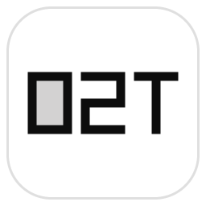

# OpenCode2Trae



把 **OpenCode Go** 的订阅接到 **Trae** 里用的本地中转站（带界面）。

## 下载（不想装 Python 就下这个）

打包好的 exe，双击直接用，**不用装 Python**：

**https://github.com/HZDavy/OpenCode2Trae/releases/latest**

> 第一次运行 Windows 可能弹「已保护你的电脑」蓝框 → 点「更多信息」→「仍要运行」即可。

## 它解决什么问题

OpenCode Go 要求每个请求都带一张"通行证"——一个叫 `x-opencode-session` 的请求头。
而 Trae 的自定义模型**没有地方能填请求头**，于是请求被上游拦下，Trae 就报：

```
WebSocket error: Network IO error: ... (HTTP Status: 500) (4028)
```

这个小程序在你本机开一个中转站：接住 Trae 的请求 → 补上那个头 → 转给 OpenCode。
问题就没了。

## 功能

- 一键**启动 / 关闭**中转站
- 记住你的 API 密钥，方便随时复制
- 界面里内置**直达按钮**：一键打开 OpenCode 官网、一键打开 API 管理页面
- 内置 Go 套餐全部 **32 个模型**的名称和 ID，双击即复制
- 同时支持 **OpenAI 格式** 和 **Claude（Anthropic）格式**
- 单文件、零第三方依赖（只用 Python 标准库）

## 运行环境

- Windows
- 用 exe 版：**什么都不用装**
- 用源码版：Python 3.8+（自带 tkinter 即可，不需要 pip 装任何东西）

## 怎么用

1. 双击 `OpenCode2Trae.exe`（源码版则双击 `OpenCode2Trae.bat`，或命令行 `python OpenCode2Trae.py`）。
2. 点界面最上面的「**启动桥接**」。左上角指示灯变绿 = 通了。
3. 切到「**接入地址**」页，把 Go 套餐的密钥粘进去、点「保存」（方便以后复制）。
4. 打开 Trae → 模型设置 → 添加自定义模型，按下表填：

   | 想用的模型 | API 格式 | 自定义请求地址 |
   | --- | --- | --- |
   | GPT / Gemini / Grok / DeepSeek / Qwen / Kimi / GLM 等 | OpenAI Chat Completions | `http://127.0.0.1:8787/v1` |
   | Claude | Anthropic Messages | `http://127.0.0.1:8787/anthropic/v1` |

   （界面里把「完整 URL」开关打开的话，就填各自带 `/chat/completions`、`/messages` 的那一版）
5. 「模型 ID」到「**模型清单**」页复制；「API 密钥」填你自己的密钥。

## 注意事项

- 本程序必须**一直开着**。关掉窗口 = 断线。
- 它是纯本机的中转站，不往任何地方上传你的数据；密钥只写在程序旁边的
  `opencode2trae-config.json` 里（**明文**，别把这个文件传给别人）。
- 某个模型报「不支持图片输入」→ 去 Trae 的高级配置把「支持图片输入」关掉。
- 报 401 之类的鉴权错误 → 是密钥的问题，不是桥接坏了。

## 文件说明

| 文件 | 说明 |
| --- | --- |
| `OpenCode2Trae.py` | 程序本体（单文件，零依赖） |
| `OpenCode2Trae.bat` | 双击启动（不弹黑窗口） |
| `OpenCode2Trae.ico` / `icon.png` | 图标（多尺寸 .ico + 256px .png） |
